# CalcShelf user guide

This guide covers every part of CalcShelf: the CAS, the TI-36X Pro recreation, the libraries, and each emulated calculator, including how to load its operating system.

- [The basics: tabs, menus, saving](#the-basics)
- [The CAS tab](#the-cas-tab)
  - [Keypad](#keypad) · [Entering math](#entering-math) · [Results and history](#results-and-history) · [Uncertainty](#uncertainty-propagation) · [Units](#units) · [Menus and catalog](#menus-and-catalog) · [Settings](#settings)
- [Other tabs: Graphs, Lists & Spreadsheet, Notes, Program Editor, Unit Converter](#other-tabs)
- [Constants, formulas, trig and conversions](#constants-formulas-trig-and-conversions)
- [TI-36X Pro](#ti-36x-pro)
- [Emulated calculators](#emulated-calculators)
  - [Adding, switching, several at once](#adding-and-switching) · [What every emulator page has](#what-every-emulator-page-has)
  - [TI-Nspire CX II CAS](#ti-nspire-cx-ii-cas) · [TI-89 Titanium](#ti-89-titanium) · [TI-92, TI-92 Plus, Voyage 200](#ti-92-ti-92-plus-voyage-200) · [TI-84 Plus family and other Z80 models](#ti-84-plus-family-and-other-z80-models) · [HP 48 and HP 49](#hp-48gx-hp-48sx-hp-49g-hp-49g)
- [Backup, restore and moving to a new phone](#backup-and-restore)
- [Troubleshooting](#troubleshooting)

---

## The basics

**Tabs.** Everything lives in one document made of tabs along the top. The first tab is always **CAS**.

- **Tap a tab** to go to it.
- **Tap the open tab** to get its menu: rename, move, close, export history, and so on.
- **Long-press a tab** to rename it.
- **Tap +** to add a tab: an emulated calculator (this includes the TI-36X Pro), Graphs, Lists & Spreadsheet, Notes, Program Editor, the Unit Converter, or **Guide & manuals**.
- **Guide & manuals** (also in the main menu ☰) holds this whole guide, and links to the official manuals of every calculator CalcShelf runs. Those open in your browser.
- **Screen rotation:** the CAS and the TI-36X Pro stay upright, and the TI-92, TI-92 Plus and Voyage 200 always run in landscape. The other tabs turn with the phone.

**Main menu (☰, top left).**

- **Settings**
- **Constants & formulas**
- **Trigonometry & triangle solver**
- **Conversion tool**
- **Add an emulated calculator** (or **Replace OS or change calculator**)
- **Rename tabs**
- **Back up** and **Restore from backup**

**The angle badge** (RAD or DEG, top right) shows the CAS angle mode. Change it in **Settings → Angle**.

**Saving is automatic.** Every tab, the CAS history and variables, and each emulated calculator's memory are saved on the phone as you go. Calculators also save when you leave the app. Nothing is sent anywhere.

**Dark mode** follows the phone. To choose yourself, go to **Settings → Theme**.

---

## The CAS tab

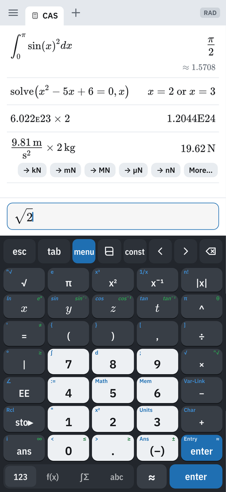

The CAS tab is a full computer-algebra calculator: exact arithmetic, algebra, calculus, linear algebra, statistics, units and more. It is powered by **Giac**, the engine behind Xcas.

You type into the entry line at the bottom. Results stack up above it, the newest at the bottom.

### Keypad

The toolbar above the keypad has full-size keys (**esc** and **tab** are the wider ones):

| Key | Does |
|---|---|
| **esc** | Closes a menu, or clears the entry line. |
| **tab** | Jumps to the next box (placeholder) in a template. |
| **menu** | Opens the CAS menu. |
| **▤** | Opens the catalog. |
| **const** | Opens Constants & formulas. |
| **‹ ›** | Moves the cursor. |
| **⌫** | Deletes. Hold it to keep deleting. |

The top row of the **123** page has **√** (long-press for ⁿ√), **π** (long-press for e), **x²** (long-press for x³), **x⁻¹** (long-press for 1/x) and **|x|** (long-press for n!).

**Keypad pages.** The strip below the keypad switches between them:

- **123:** numbers and operators, laid out like the TI-89's.
- **f(x):** functions.
- **∫Σ:** calculus and sums.
- **abc:** letters.

The **≈** key evaluates to a decimal instead of an exact answer. **enter** evaluates exactly.

**Second functions.** Keys show a blue **2nd** legend and a green **◆** legend, as on the TI-89. **Long-press a key** to choose one of them.

**Hardware keyboards** work: type normally, and Enter evaluates.

### Entering math

- The entry line is a 2D math editor. Fractions stack, exponents rise, and √, ∫ and matrices have boxes to fill in. **tab** moves to the next box.
- **Division is always a fraction.** ÷ (and typing `/`) makes a stacked fraction from the term before the cursor.
- **Parentheses come in pairs.**
  - **(** inserts **( )** with the cursor inside.
  - **)** steps out of the enclosing pair.
  - With nothing open, **)** wraps everything before it: `2+3)` becomes `(2+3)`.
- **A new line starts from ans.** On an empty line, pressing + − × ÷ ^ x² ! % or sto▸ inserts **ans** first, as on a TI calculator. (−) still starts a negative number. Turn this off with **Settings → New line starts from ans**.
- **Variables and functions:**
  - **Store a value:** `3 sto▸ a`.
  - **Define a function:** use `f(x):=x^2+1`, or **menu → Actions → Define**.
  - **See what's defined:** use **menu → Actions → Variables**.
- **ans** recalls the last answer. **Long-press enter** to choose **Entry**, which recalls the last entry for editing, or **≈**.
- **In the history, ans shows its value.** `ans×2` after 5 is saved as `5×2`.
- **EE works as on a TI calculator.** It types a small capital **ᴇ**, and the exponent goes on the same line: `6.02ᴇ23`, `1.5ᴇ−3` (use **(−)** for the minus). The number and its exponent count as one number, so `1/2ᴇ3` is 1/2000.

### Results and history

Each result row shows the input on the left and the answer on the right.

- **Exact and decimal together.** An exact answer such as √2 also shows its decimal (≈ 1.414 21) underneath. Turn this off with **Settings → Decimal under exact answers**.
- **Digit grouping.** Long numbers show thin spaces: 1 099 511 627 776. This setting never affects values you insert.
- **Tap a result** to open its menu:
  - **Insert** the answer or the input.
  - **Copy text** or **Copy LaTeX**.
  - **Pin** it to the top of the page.
  - **Convert units**, for a result with units.
  - **Uncertainty budget**, for a result with ±.
  - **Delete**.
- **Swipe a row left** to delete it. Tap **Undo** to bring it back.
- **Pins** stay at the top, and **Clear history** keeps them.
- **Export history (CSV):** tap the open CAS tab. The file has the inputs, results, decimals, uncertainties, units and times.

### Uncertainty propagation

Type values as **value ± σ**. The ± key is the long-press option on (−), and it is also on the f(x) page. For example:

`(5.03 ± 0.02) × (2.1 ± 0.1)` → **10.56 ± 0.50** (relative ± 4.8 %)

- **How it's calculated:** first order, for independent inputs, using numeric partial derivatives. Any function and either angle mode works: `sin(0.5 ± 0.01)`, `(12.0 ± 0.3)/(4.00 ± 0.05)²`, and so on.
- **The uncertainty budget:** tap the result for a table of each input's sensitivity, contribution and share of the total.

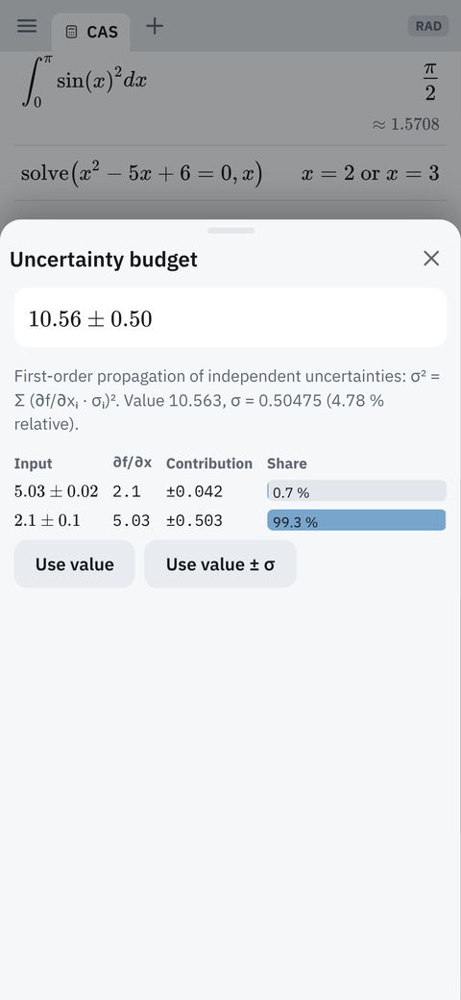

### Units

Units are written with an underscore, as on the TI-89: `_m`, `_kg`, `_s`, `_ft`, `_N`, `_J`, `_eV` and so on. Pick them from **menu → Units**, or type them.

- **The Units sheet** lists about 300 units in 130 quantities, from length and pressure to GVD (fs²/mm), D* and noise densities (V/√Hz). Search it by name (*debye*, *torr*). Type any combination in its box, such as `W/(m·K)` or `mW/(cm²·nm)`, and tap **Insert**.
- **Every unit computes correctly.** Giac, the CAS engine, misreads some names (it takes `_Da` as deca-are). CalcShelf hands those to it in SI form, so `3_Da→_kg`, `1_kn→_m/_s` or `2_furlong→_m` come out right.
- **Temperatures:** `20_°C→_°F` gives 68 °F. In other calculations a temperature counts as a difference.
- **Combined units are tidied:**
  - The same unit above and below cancels: `5_W/(_m·_K)·2_m` gives **10 W/K**.
  - Units of one kind mixed together go to SI: `3_ft·2_m` gives **1.8288 m²**, and `5_mm·2_km` gives **10 m²**.
  - Several units that make a common named unit become it: `100_J/4_s` gives **25 W**, and `3_V·2_A` gives **6 W**. N·m stays N·m, because it is usually a torque.
  - A unit you ask for with **→** is kept as written, for example `25_W→_J/_s`.
- **Your own units and constants:** open **const → Mine**.
  - A unit has a symbol and a definition, for example `_thou = 25.4 µm`. It then works in the CAS, the conversion tool and its lists.
  - A constant has a name and a value, for example `lref = 1550.12 nm`. It becomes a CAS variable in every document.

- **Clean results.** Results come out with tidy unit names: `9.81_m/_s²·2_kg` → **19.62 kg·m/s²**.
- **Convert chips.** The newest answer has one-tap chips, such as **→ N**, **→ kN** and **More…**. **More…** takes any compatible unit.
- **Older answers** convert from their tap menu.

### Menus and catalog

**menu** opens the CAS menu, grouped like a TI calculator's:

- **Actions:** Define, Recall definition, Delete variable, Clear a–z, Clear history, Variables, and the library.
- **Number:** decimal and fraction conversion, factor, lcm and gcd, remainders, rounding, complex-number tools, primes and divisors, number bases.
- **Algebra:** solve, factor, expand, zeros, numerical solve, systems, polynomial tools, fraction tools, expression conversion, trigonometry.
- **Calculus:** derivatives, integrals, limits, sums and products, series, differential equations.
- **Probability, Statistics and distributions, Matrix & Vector** (including eigenvalues and LU/QR decompositions), **Finance**, **Functions & Programs**, and **Units**.

Most items insert a template; fill in its boxes and press enter. The **catalog (▤)** is a searchable list of every command, with its syntax and a short description.

### Settings

| Setting | Choices |
|---|---|
| Angle | Radian, Degree |
| Calculation mode | Auto, Exact, Approximate |
| Display digits | Float 6, 8, 10, 12 |
| Number format | Normal, Sci, Eng (exponents in multiples of 3) |
| Decimal under exact answers | On, Off |
| Digit grouping | On, Off |
| New line starts from ans | On, Off |
| Complex results | a+bi, Real only |
| Emulated calculators | One tab, or several running at once ([see below](#adding-and-switching)) |
| Theme | System, Light, Dark |

---

## Other tabs

Add these from **+**.

- **Graphs.**
  - Plot functions; pan with one finger and pinch to zoom.
  - **Trace:** tap a curve.
  - **Zoom** and **Window** presets.
  - **Plot types:** function, parametric, polar and scatter.
  - **Analysis:** zero, minimum, maximum, intersection, dy/dx and integral.
  - **Table of values.**
- **Lists & Spreadsheet.**
  - Named columns, column formulas, and cells that hold math.
  - **Statistics:** one- and two-variable statistics; linear, quadratic, exponential and power regressions.
  - Pick one of these from the menu to plot it.
- **Notes.** Text blocks with live math boxes that evaluate, as on the TI-Nspire.
- **Program Editor.**
  - Write TI-Basic functions and programs (`Func…EndFunc`, `Prgm…EndPrgm`).
  - A program can then be called from the CAS tab like any built-in function. The editor starts with a Fibonacci example.
- **Unit Converter.** It has four parts:
  - **Units:** choose a quantity, then pick the From and To units from the dropdowns. For a unit that isn't listed, choose *Other unit…* and type it, for example W/(m·K).
  - **Optics** has five calculators:
    - **Δν ↔ Δλ:** enter a centre wavelength or frequency and a width Δλ or Δν, then pick the unit to show the width in. For example, an OSA resolution of 0.02 nm at 1550 nm is 2495.7 MHz. It also gives the coherence length, Q and the photon equivalents of the centre.
    - **Beam:** a Gaussian beam (wavelength, waist, M²) through free space, thin lenses, mirrors, glass slabs or any ABCD matrix. It plots w(z) and gives the new waist and its position. Add a target waist to see the coupling efficiency (mode matching).
    - **Dispersion:** pick a glass or crystal (or enter Sellmeier coefficients) and a wavelength. You get n, the group index, β₂, D, β₃, the zero-dispersion wavelength, and the delay, GDD and TOD of a thickness, with a plot against λ.
    - **Etalon:** a Fabry–Pérot from its length, index and mirror reflectances. You get the FSR, finesse, linewidth, Q, photon lifetime and contrast, with the transmission curve.
    - **Thin film:** reflectance of a layer stack (transfer matrices) against wavelength, at any angle and polarisation. Thicknesses are in nm or quarter waves, and indices can be complex (n+ki). There are presets for an MgF₂ AR coat and quarter-wave mirrors.
  - **Number base** and **Decibels.**

---

## Constants, formulas, trig and conversions

Open this from **const** on the toolbar, or from the main menu. It has four tabs.

- **Constants:**
  - The CODATA physical constants, plus material and optical data (refractive indices, dn/dT, and so on).
  - Each one can be shown in several units.
  - Search by name, for example *Planck*, *BK7* or *dn/dT*.
  - Tap a constant to insert it, or to open it in the conversion tool.
- **Formulas:** solvable formulas by category. Fill in all but one variable, and CalcShelf solves for the one you leave blank.
- **Trig:**
  - **Triangle solver:** SSS, SAS, ASA, AAS, and the ambiguous SSA case, which shows both triangles. It gives the area, perimeter, heights and the circumradius and inradius, with a scaled drawing.
  - **Identities:** about 40 identities and an exact-value table. Insert any one, or have the CAS verify it.
  - **Trig formulas.**
- **Convert:** the same tool as the Unit Converter tab.

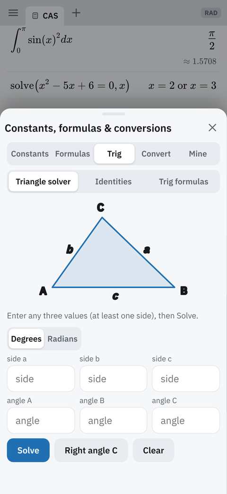

---

## TI-36X Pro

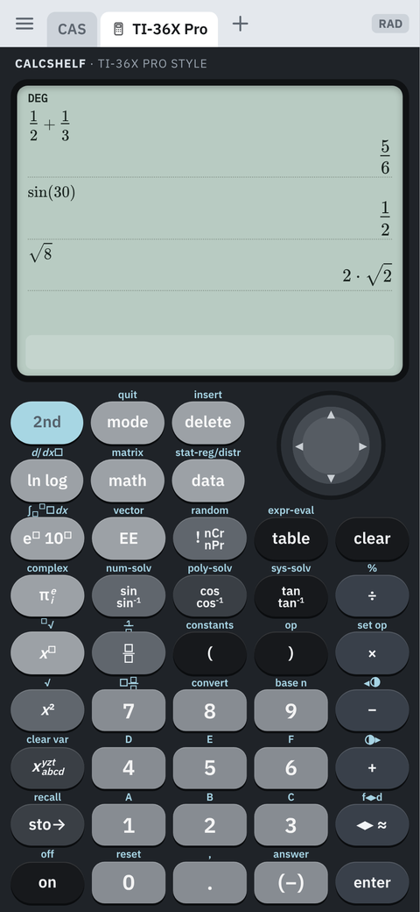 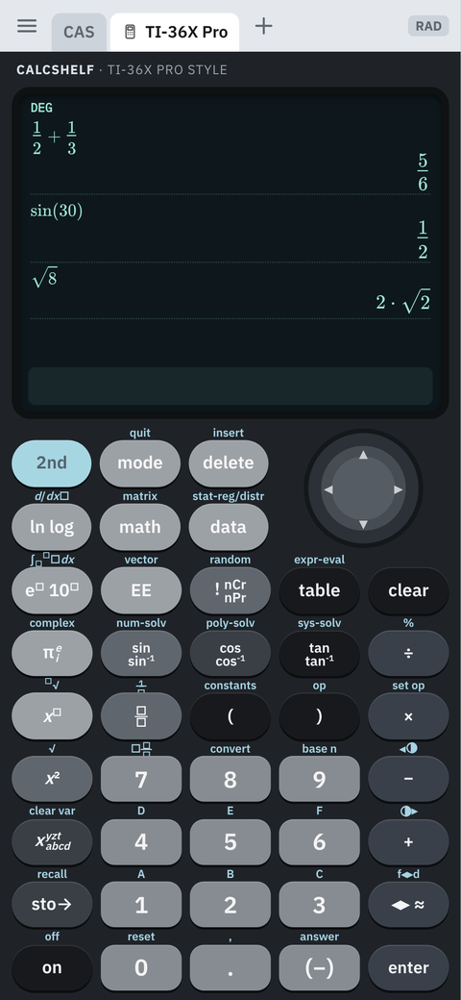

This is a recreation of the current TI-36X Pro's keypad, MultiView display and menus. It runs on the CAS engine, so it is not an emulation and needs no firmware.

Open it from **+ → Emulated calculator → TI-36X Pro** (under *TI scientific*). With one emulator tab, switching that tab to another calculator keeps the TI-36X Pro's memory for when you switch back.

- **Keys** are where they are on the real calculator, with their 2nd legends above them. Press **2nd** for the second function.
- **Multi-tap keys** work as on the real calculator: tap again within 1.6 s for the next legend. These keys are:
  - ln / log
  - e□ / 10□
  - π / e / i
  - sin, cos and tan, with their inverses
  - ! / nCr / nPr
  - x / y / z / t / a / b / c / d
- **Menus:**
  - **math:** MATH, NUM, DMS, R◂▸P and HYP.
  - **random:** RAND and PRB.
  - **base n:** conversions, number types and logic.
  - Also: data and statistics with regressions and distributions; table of f(x); num-solv, poly-solv and sys-solv; matrix and vector editors; constants; convert; expr-eval; op and set op.
- **Answers:** exact or decimal, fractions and mixed numbers, DEG/RAD/GRAD with DMS, and complex numbers in a+bi or r∠θ form.
- **Contrast** is 2nd − and 2nd +, as on the real calculator.
- **Night display:** tap the open TI-36X Pro tab and choose **Night display**. It gives a dark screen with light text, and is saved with the TI-36's settings.
- **Export history (CSV)** and **Reset** are in the same tab menu.

 

---

## Emulated calculators

These run the calculators' own operating systems on emulator cores. The calculator behaves exactly like the real one, including its menus, apps, programs and quirks.

### Adding and switching

- **Add one:** tap **+ → Emulated calculator**, pick a model, and then load its OS (TI) or just open it (HP). The tab is named after the model (TI-89, V200, HP 48GX …); rename it if you like.
- **Change model or OS:** tap the open emulator tab and choose **Replace OS or change calculator**.
  - **Each model keeps its own OS and memory**, so you can switch back and forth.
  - Choosing an OS file that belongs to another model switches to that model automatically.
- **Several at once:** turn on **Settings → Emulated calculators → Several, running at once**.
  - Each emulator tab is then a different model. Picking a model that is already open takes you to its tab.
  - Background tabs keep running at their own speed, so a long program keeps going while you use another tab.
  - This uses more battery and memory; the TI-Nspire alone needs about 330 MB.

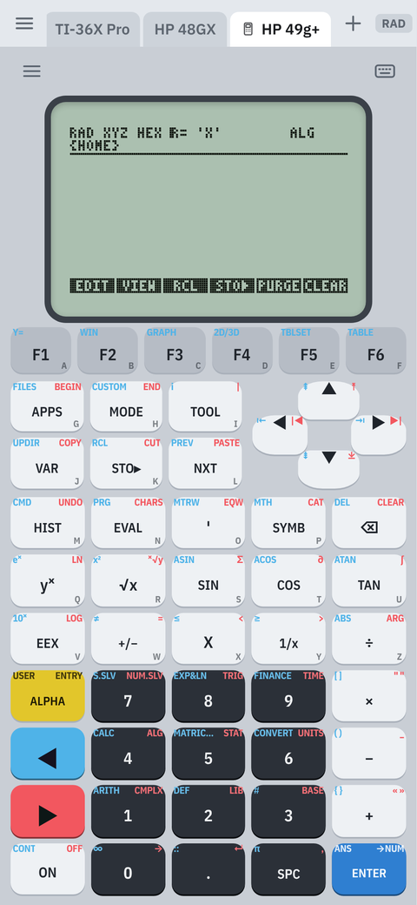

### What every emulator page has

- **☰ menu:** files (send programs or documents, screenshots), snapshots or save, restart, replace OS, screen style, and speed.
- **⌨ type:** type text with the phone keyboard. CalcShelf presses the right keys for you.
- **Long-press a key** to choose its 2nd, ◆, shift or alpha function. Arrows and ⌫ repeat while held.
- **Hardware keyboards:** letters, digits, arrows, Enter, Backspace and Escape all work.
- **Speed:** real speed by default. Faster settings help with long programs and graphs.
- **Saving:** state is saved automatically, and the calculator resumes exactly where you left it.

### TI-Nspire CX II CAS

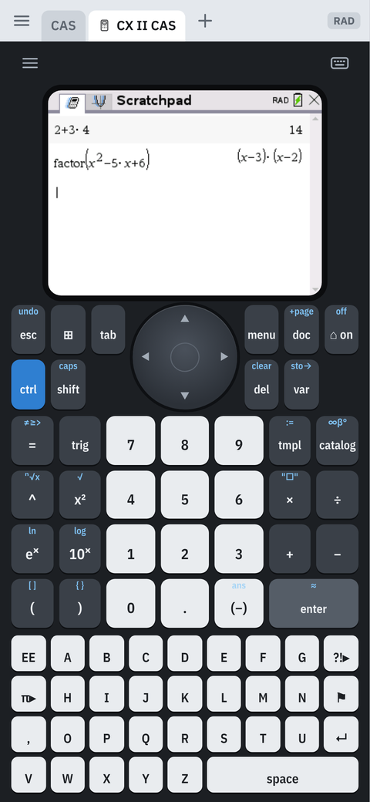

This runs the real TI-Nspire OS on **Firebird**, the community TI-Nspire emulator.

**What you need.** The CX II can't be emulated with TI's OS file alone. Firebird also needs the calculator's own boot and system files, dumped from a calculator you own:

| File | Typical name | Needed |
|---|---|---|
| Boot ROM **with its keys** | `injected_btrom.img` | Yes |
| Manufacturing data | `manuf.img` | Yes |
| Boot loader | `btldr.img` | Yes |
| Installer | `instl.img` | Yes |
| Diagnostics | `diags.img` | Optional |
| The OS | `TI-NspireCXIICAS-6.x.x.tcc2` from education.ti.com | Yes |

The OS loader (`osldr.img`) isn't needed. A boot ROM *without* keys (plain `btrom.img`) won't work; you need the one with keys injected.

**Getting the files.** The dumps are made on the calculator with community tools:

1. Install **Ndless** (ndless.me) on a CX II whose OS version it supports.
2. Run a dumper such as **PolyDumper** to save the system files.
3. Add the keys to the boot ROM with **eMMUlate**.

The Firebird project and the TI-Planet community document the current steps. Follow them for your OS version, because the supported versions change over time.

**Setting it up:**

1. Add an emulator tab, choose **TI-Nspire CX II CAS → Choose system files and OS…**, and select all the files at once. Names don't matter; CalcShelf recognises each file by its contents and tells you if one is wrong or missing.
2. Press **Install the OS**. CalcShelf builds the flash from your files and runs TI's own installer. This takes about two minutes, once: about 30 s to send the OS, then about 70 s for the first start.
3. Choose your language on the calculator. After that, the calculator resumes in about a second.

**Using it:**

- **The clickpad:**
  - Tap its edge to move like the arrows; tap its centre to click.
  - Hold it to grab.
  - The keypad is the CX II's.
- **⌨** types into the calculator. Exponents go into the raised box and are left with →.
- **Menu:**
  - **Send documents:** `.tns` files go to My Documents.
  - **Save screenshot**, **Save state now**, **Restart**.
  - **Replace OS:** send a newer OS file.
  - **Erase this calculator:** removes its flash, state and system files from the phone.
- **Speed:** busy work runs at about half the real calculator's speed; idle screens are instant. The status line shows the current speed.

 

### TI-89 Titanium

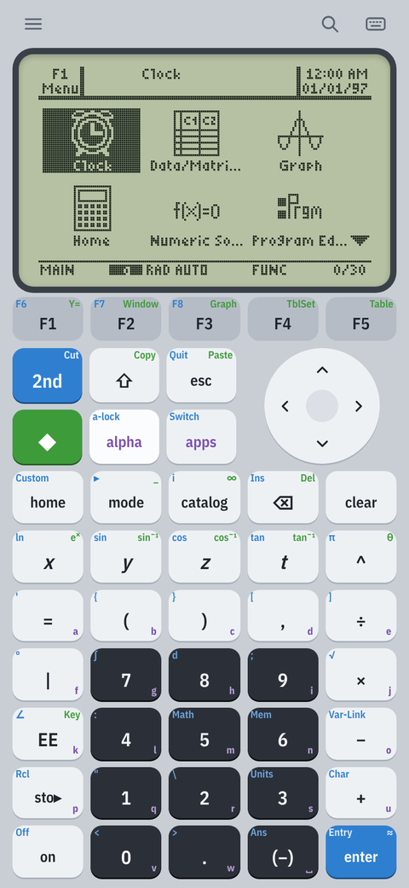

This runs **TI AMS** on the **TiEmu** core (from Graph89).

- **What you need:** a TI-89 Titanium or TI-89 OS upgrade (`.89u`), free from education.ti.com, or a ROM dump (`.rom`) of your calculator.
- **Setting it up:** add an emulator tab, choose **TI-89 Titanium → Choose OS file or ROM…**, and pick the file.
- **Keys:** the keypad is the 89's, with 2nd (blue), ◆ (green) and alpha (purple) legends.
  - Tap 2nd, ◆, shift or alpha to latch it; the keys then show their alternate functions.
  - Long-press a key to choose its function directly.
- **Typing (⌨):** text is converted to TI characters as it's typed, for example `->` becomes →, `<=` becomes ≤, and `sqrt(` becomes √(. The chips give π, √, ∫, ∞, θ and more, and recent entries are kept.
- **Command finder (🔍):** a searchable reference of more than 360 TI-89 commands, with syntax, a description and where the command is found on the calculator. **Insert** types it for you.
- **Menu:**
  - **Send programs or variables:** `.89p`, `.89e`, `.89f`, `.89g`, `.89k` and more.
  - **Received files:** what you send from Var-Link appears here to save.
  - **Save screenshot**, **Save snapshot** and **Restore snapshot**.
  - **Set clock to phone time**, **Restart**, **Replace OS**.
- **Settings:** screen style (Classic, Paper, Night), grayscale for games and pictures, pixel grid, and speed (Real, 2×, 4×, or full speed while busy).

 

### TI-92, TI-92 Plus, Voyage 200

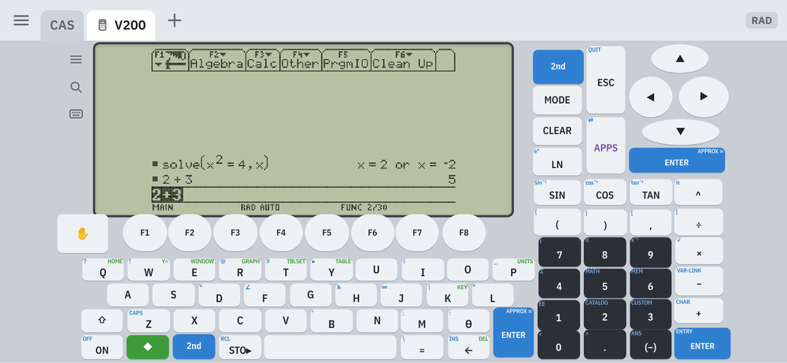

These use the same TiEmu core, with Graph89's landscape layout: every key is where it is on the real calculator.

- **Voyage 200:** the F1–F8 keys run under the screen.
- **TI-92 and TI-92 Plus:** F1–F8 sit in two columns to the left of the screen.
- **All three:** the cursor pad and number block are on the right, and the QWERTY keyboard is below. Each key shows its 2nd and ◆ legends.

**Landscape only.** On the phone, CalcShelf turns the screen to landscape while one of these is open. In a browser held in portrait, the page turns itself so that you can just rotate the device.

**What you need:**

- **TI-92 Plus:** a `.9xu` OS upgrade or a ROM dump.
- **Voyage 200:** a `.v2u` OS upgrade or a ROM dump.
- **Original TI-92:** a ROM dump; it has no OS upgrade files.

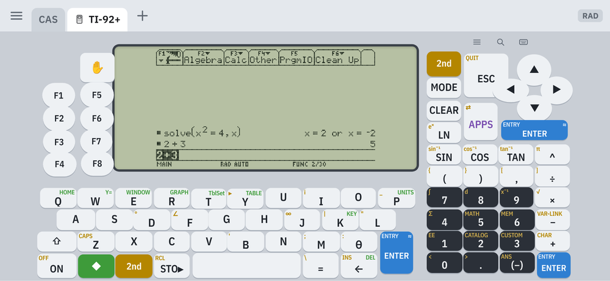

### TI-84 Plus family and other Z80 models

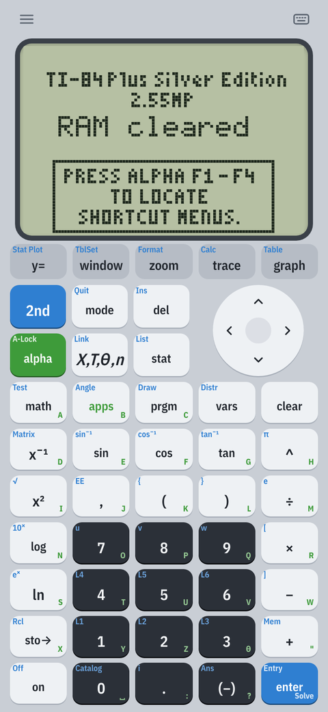

These run the **TI-OS** on the **TilEm** core.

| Model | Load |
|---|---|
| TI-84 Plus Silver Edition, TI-84 Plus, TI-83 Plus SE, TI-83 Plus | an OS file (`.8xu`) or a ROM dump |
| TI-73 Explorer | an OS file (`.73u`) or a ROM dump |
| TI-83 / TI-82 STATS, TI-82, TI-85, TI-86, TI-81 | a ROM dump |

**Using them:**

- Each model has its own keypad, with its 2nd and alpha legends in that model's colours.
- **Send programs, variables or apps:** `.8xp`, `.8xg`, `.8xk` and so on.
- **Auto-contrast** evens out the dark contrast that a real OS often sets; it's in the menu.
- **Snapshots**, **Restart** and **Replace ROM or OS** are in the menu too.

 

### HP 48GX, HP 48SX, HP 49g+, HP 49G

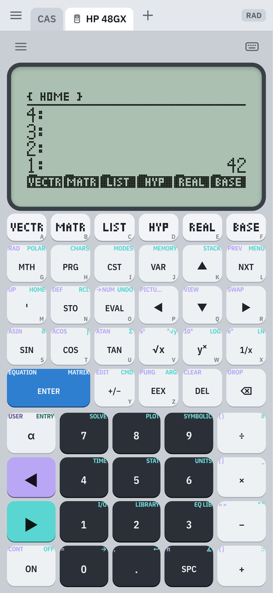 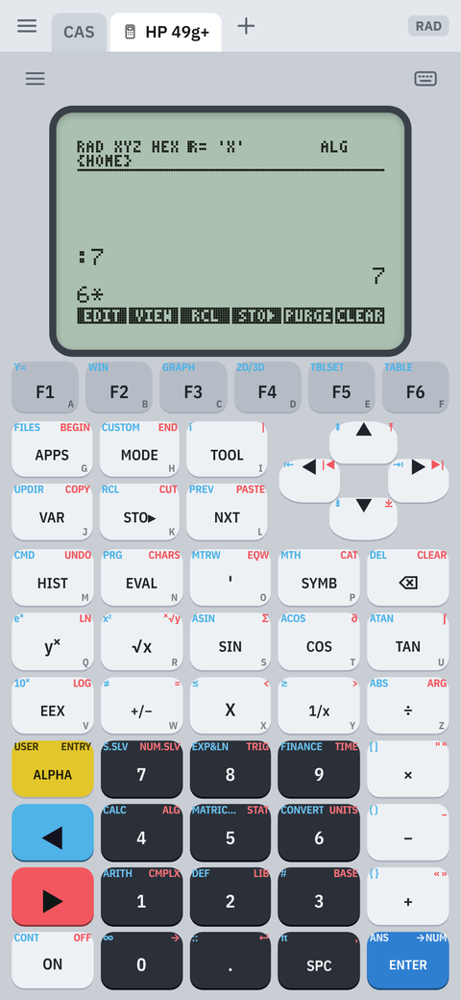

These run **HP's own ROMs** on the **Emu48** core. The ROMs are included, so the calculators are ready to use with no setup:

- **48GX:** revision R.
- **48SX:** revision E.
- **49g+ and 49G:** ROM 2.10.

**First start.** A new calculator asks *Try To Recover Memory?*, and CalcShelf answers NO for you. Then you'll see *Memory Clear*, as on a real calculator. The 49 models start in algebraic mode; use **MODE** to switch to RPN.

**Keys:**

- The keypads match the real calculators. Left-shift and right-shift legends are in each model's colours: orange and blue on the 48SX, purple and teal on the 48GX, blue and red on the 49s. Alpha letters are on each key.
- **◀ and ▶** shift the next key, and the keys then show their shifted functions. **α** is alpha; **α α** locks it.
- **Long-press** a key to pick its left-shift, right-shift or alpha function.
- **The HP 48's A–F keys** show the labels of the menu on screen (VECTR, MATR, LIST …), and change as the menu changes.
- **Arrows and ⌫** repeat while held. Holding a menu key shows its full name, as on the real calculator.

**Typing (⌨).** Characters are pressed as keys: letters use alpha lock, and ( [ { " « use the shift keys. You can also choose **Put it on the stack as text** to get a string object.

**Menu:**

- **Load an object:** `.hp` or `.lib` binaries, or a text file, go on stack level 1.
- **Save screenshot**, **Save now**.
- **Restart:** like ON+C; memory is kept.
- **Memory clear.**
- **Speed:** Real, 2×, 4× or Max (about 30× a real 48GX).
- **Screen style:** Classic, Paper or Night.

**Memory** is saved every 20 seconds and when you leave the app. On the 49 models this includes the flash memory (port 2).

 

---

## Backup and restore

- **Back up** (main menu) saves all tabs, CAS variables and history as a `.tns.json` file.
- **Restore from backup** replaces the current tabs with a backup.
- **Emulated calculators** keep their memory separately on the phone:
  - **TI calculators:** use each one's snapshots, or send their files to the computer through Var-Link and keep those.
  - **HP calculators:** use **Load an object** to bring programs back.
- **On a new phone:** reload your TI OS files and dumps. They are never included in a backup.

---

## Troubleshooting

| Problem | Try |
|---|---|
| A TI calculator says the OS file didn't work | Make sure it's the OS for that model: `.89u` for the TI-89, `.9xu` for the 92 Plus, `.v2u` for the V200, `.8xu` for the 84/83 Plus. For other models use a ROM dump. |
| The TI-Nspire says a boot ROM has no keys | Use the `injected_btrom` file from eMMUlate, not the plain `btrom`. |
| The TI-Nspire says the WebView is too old | Update **Android System WebView** (or Chrome) from the Play Store. |
| The TI-Nspire is slow | It runs at about half real speed while busy. Set **Speed → As fast as possible**, and close other emulator tabs. |
| An HP 49 gives *Invalid Syntax* for RPN input | It's in algebraic mode. Use **MODE → Operating mode → RPN**. |
| A calculator's keys seem to do nothing | It may be off or asleep: press **ON**. On the TI-Nspire, wait for the first start to finish. |
| The screen is too dark or too light | TI: use the calculator's own contrast keys (◆ + / ◆ − on the 89; 2nd ▲ / ▼ on the 84), or turn on auto-contrast for the Z80 models. TI-36X Pro: 2nd − / 2nd +. |
| A calculator got into a strange state | **☰ → Restart** keeps memory. **Replace OS** or **Memory clear** starts fresh. |
| The phone gets warm with several calculators | Turn off **Settings → Emulated calculators → Several**, or close tabs you aren't using. |

Problems and ideas are welcome as GitHub issues.
